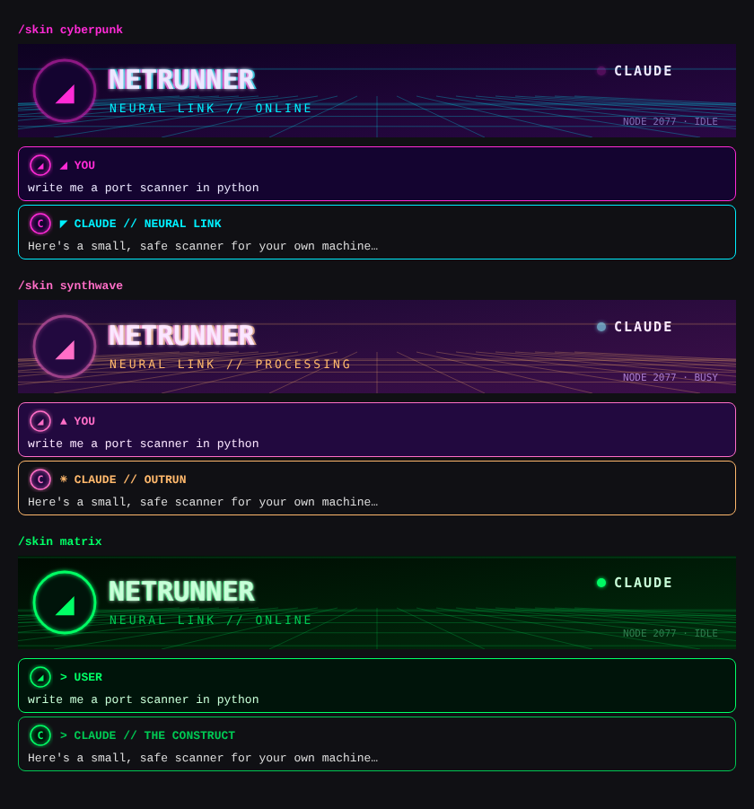

# cod-skin

Neon skins for the Claude Code chat. Your messages and Claude's become glowing cyberpunk cards, an animated banner sits above the prompt box, and you can put your own avatar and background picture on it.

ธีมนีออนสำหรับแชทของ Claude Code: ข้อความของเราและของ Claude กลายเป็นการ์ดเรืองแสงสไตล์ cyberpunk มีแบนเนอร์เคลื่อนไหวเหนือช่องพิมพ์ และใส่รูปโปรไฟล์กับภาพพื้นหลังของตัวเองได้



*Preview: the banners are the real SVG the plugin draws; the message cards are a mock-up of how the app lays them out.*
*ภาพตัวอย่าง: แบนเนอร์คือ SVG จริงที่ plugin วาด ส่วนการ์ดข้อความเป็นภาพจำลอง*

## What it does / ทำอะไรได้

- **3 skins / 3 ธีม:** `cyberpunk` (magenta, cyan and yellow on deep violet), `synthwave` (sunset pink and orange), `matrix` (phosphor green). `off` gives the chat back as usual.
- **Neon message cards / การ์ดข้อความนีออน:** your messages and Claude's replies get glowing frames, headers and portraits.
- **The rest of the chat / ส่วนอื่นของแชท:** slash-command output becomes a neon readout, tool calls ("Running a command") get neon frames that light up while they run, and the working indicator shows the step in capitals.
- **Animated banner / แบนเนอร์เคลื่อนไหว:** a scrolling neon grid, a scanline, your portrait with a pulsing ring, and your name with a glitch effect. It shows `PROCESSING` while Claude works and `ONLINE` when idle.
- **Your avatar and background / รูปโปรไฟล์และพื้นหลัง:** any PNG, JPEG, GIF or WebP picture on your computer.
- **Two layouts / 2 แบบ layout:** `cards` (full width) or `bubbles` (your messages on the right, like a chat app).
- Works alongside [hacker-screen](https://github.com/tankun1928/hacker-screen): the banner stacks with its screen.

## วิธีติดตั้ง (ภาษาไทย)

**ต้องใช้:** Claude Code ที่รันบนเครื่องของคุณเอง คือ**แอป Claude desktop (แท็บ Code)** หรือ **Claude Code บน terminal**
(session บนคลาวด์ที่ดูผ่านหน้าเว็บ claude.ai ใช้ไม่ได้ เพราะไม่มีจอให้วาด)

### ติดตั้งในแอป Claude desktop

1. เปิดแอป Claude ไปที่แท็บ **Code** แล้วเริ่ม session บนเครื่องตัวเอง (เลือกโฟลเดอร์ในเครื่อง ไม่ใช่ cloud)
2. กดปุ่ม **+** ข้างช่องพิมพ์ → **Plugins**
3. กด **Add marketplace** แล้วใส่ `tankun1928/cod-skin`
4. กด **Add plugin** แล้วเลือก **cod-skin**
5. ปิดแอปแล้วเปิดใหม่ แชทจะเปลี่ยนเป็นธีม cyberpunk ทันที

### ติดตั้งผ่าน terminal

พิมพ์ `claude` เพื่อเปิด Claude Code แล้วพิมพ์ในช่องแชท:

```
/plugin install cod-skin --marketplace tankun1928/cod-skin
```

กด `y` แล้วกด Enter

### วิธีใช้

พิมพ์ `/skin` เพื่อดูเมนูทั้งหมด:

| คำสั่ง | ทำอะไร |
| --- | --- |
| `/skin cyberpunk` / `synthwave` / `matrix` | เปลี่ยนธีม |
| `/skin off` | ปิดธีม กลับเป็นแชทปกติ |
| `/skin layout bubbles` | ข้อความของเราอยู่ขวาแบบแอปแชท (`cards` = เต็มความกว้าง) |
| `/skin name Neo` | ชื่อบนแบนเนอร์และบนข้อความของเรา |
| `/skin avatar C:\Users\me\Pictures\me.jpg` | ตั้งรูปโปรไฟล์ |
| `/skin bg C:\Users\me\Pictures\city.jpg` | ตั้งภาพพื้นหลังของแบนเนอร์ |
| `/skin clear avatar` / `/skin clear bg` | ลบรูป |
| `/skin banner off` | ซ่อนแบนเนอร์ |
| `/skin reset` | กลับค่าเริ่มต้นทั้งหมด |

**ง่ายกว่านั้น:** บอก Claude ตรงๆ ได้เลย เช่น *"ใช้รูป C:\Users\me\Pictures\me.jpg เป็นรูปโปรไฟล์ แล้วเปลี่ยนเป็นธีม synthwave"* ถ้ารูปใหญ่เกิน Claude จะย่อให้ก่อน

**ขนาดรูป:** รูปโปรไฟล์ไม่เกินประมาณ 44 KB ภาพพื้นหลังไม่เกินประมาณ 80 KB (เพราะจอวาด SVG ได้จำกัดขนาด) แนะนำรูปโปรไฟล์กว้าง 256 px และภาพพื้นหลังกว้าง 800 px แบบ JPEG

ทุกค่าจะจำไว้ข้ามแชท ไม่ต้องตั้งใหม่

### วิธีอัปเดต

- **terminal:** รันสองคำสั่งนี้แล้วเปิด Claude Code ใหม่
  ```
  claude plugin marketplace update cod-skin
  claude plugin update cod-skin@cod-skin
  ```
- **แอป desktop:** กด **+** → **Plugins** → ลบ **cod-skin** และ marketplace **cod-skin** แล้วติดตั้งใหม่ จากนั้นปิดแอปเปิดใหม่

### ถอนการติดตั้ง

- **terminal:** `claude plugin uninstall cod-skin@cod-skin`
- **แอป desktop:** กด **+** → **Plugins** → ลบ **cod-skin**

## Install (English)

You need Claude Code running on your own computer: the **Claude desktop app's Code tab** or **Claude Code in a terminal**.

**Desktop app:** click **+** next to the prompt box → **Plugins** → **Add marketplace** with `tankun1928/cod-skin` → **Add plugin** → pick **cod-skin**, then restart the app.

**Terminal**, at the Claude Code prompt:

```
/plugin install cod-skin --marketplace tankun1928/cod-skin
```

**Use it:** type `/skin` for the menu, or just ask Claude: *"use ~/Pictures/me.jpg as my avatar and switch to synthwave"*. An avatar can be up to about 44 KB and a background up to about 80 KB; Claude shrinks a larger picture first.

**Update**, then restart Claude Code:

```
claude plugin marketplace update cod-skin
claude plugin update cod-skin@cod-skin
```

**Uninstall:** `claude plugin uninstall cod-skin@cod-skin`

## What a plugin can't change (yet) / สิ่งที่ plugin ยังเปลี่ยนไม่ได้

The app's window itself (sidebar, title bar, fonts, a full-window background) is out of a plugin's reach. See [docs/feature-request.md](docs/feature-request.md) for the proposal to the Claude team.

กรอบหน้าต่างแอป (แถบด้านข้าง แถบชื่อ ฟอนต์ ภาพพื้นหลังเต็มหน้าต่าง) plugin ยังเข้าไม่ถึง ดูข้อเสนอถึงทีม Claude ได้ที่ [docs/feature-request.md](docs/feature-request.md)

## Develop

```
claude plugin validate .
claude plugin test .
claude --plugin-dir .
```
